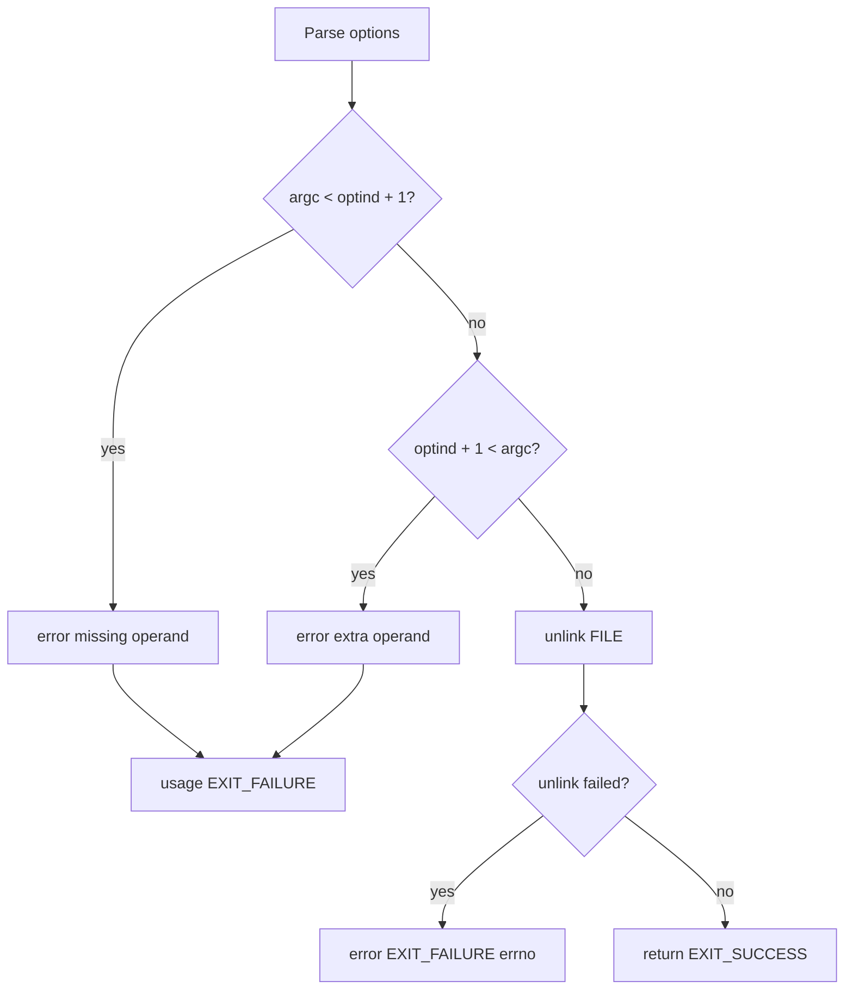

# `unlink`: remove a file

Source: `src/unlink.c` (86 lines) · Tests: `tests/misc/unlink.sh` ·
Manual: `info '(coreutils) unlink invocation'`

`unlink` removes the specified FILE by calling the system `unlink` function.
This is a low-level interface equivalent to `rm` without any options. It can
only remove one file at a time and does not accept any options.

## Options

No options other than `--help` and `--version`. Uses `parse_gnu_standard_options_only`
(`src/unlink.c:66-68`).

## Code map

|| Function | Location | Role |
||---|---|---|
|| `main` | `src/unlink.c:56` | Validate arguments, call `unlink`. |
|| `usage` | `:36` | Help text. |

## How it works

The diagram shows the simple flow.



`main` validates that exactly one operand is provided (`src/unlink.c:70-80`),
then calls the system `unlink` function (`src/unlink.c:82`). If `unlink` fails,
it reports an error and exits.

## Platform notes

- The system `unlink` function removes a directory entry and decrements the
  link count
- If the link count reaches zero and no processes have the file open, the
  file's data is freed
- `unlink` cannot remove directories (use `rmdir` instead)

## Errors and exit status

- Missing operand: `error (0, 0, ...)` then `usage (EXIT_FAILURE)`
- Extra operand: `error (0, 0, ...)` then `usage (EXIT_FAILURE)`
- `unlink` failure: `error (EXIT_FAILURE, errno, ...)`
- Write failure: handled by `atexit (close_stdout)`

## Tests

|| File | Covers |
||---|---|
|| `tests/misc/unlink.sh` | Basic functionality, error cases. |

## See also

- [rm](rm.md) (remove files with more options)
- [link](link.md) (create a hard link)
- [rmdir](rmdir.md) (remove directories)

## Source code

`src/unlink.c:1`

```c
/* unlink utility for GNU.
   Copyright (C) 2001-2026 Free Software Foundation, Inc.

   This program is free software: you can redistribute it and/or modify
   it under the terms of the GNU General Public License as published by
   the Free Software Foundation, either version 3 of the License, or
   (at your option) any later version.

   This program is distributed in the hope that it will be useful,
   but WITHOUT ANY WARRANTY; without even the implied warranty of
   MERCHANTABILITY or FITNESS FOR A PARTICULAR PURPOSE.  See the
   GNU General Public License for more details.

   You should have received a copy of the GNU General Public License
   along with this program.  If not, see <https://www.gnu.org/licenses/>.  */

/* Written by Michael Stone */

/* Implementation overview:

   Simply call the system 'unlink' function */

#include <config.h>
#include <stdio.h>
#include <sys/types.h>

#include "system.h"
#include "long-options.h"
#include "quote.h"

/* The official name of this program (e.g., no 'g' prefix).  */
#define PROGRAM_NAME "unlink"

#define AUTHORS proper_name ("Michael Stone")

void
usage (int status)
{
  if (status != EXIT_SUCCESS)
    emit_try_help ();
  else
    {
      printf (_("\
Usage: %s FILE\n\
  or:  %s OPTION\n"), program_name, program_name);
      fputs (_("Call the unlink function to remove the specified FILE.\n\n"),
             stdout);
      oputs (HELP_OPTION_DESCRIPTION);
      oputs (VERSION_OPTION_DESCRIPTION);
      emit_ancillary_info (PROGRAM_NAME);
    }
  exit (status);
}

int
main (int argc, char **argv)
{
  initialize_main (&argc, &argv);
  set_program_name (argv[0]);
  setlocale (LC_ALL, "");
  bindtextdomain (PACKAGE, LOCALEDIR);
  textdomain (PACKAGE);

  atexit (close_stdout);

  parse_gnu_standard_options_only (argc, argv, PROGRAM_NAME, PACKAGE_NAME,
                                   Version, true, usage, AUTHORS,
                                   (char const *) NULL);

  if (argc < optind + 1)
    {
      error (0, 0, _("missing operand"));
      usage (EXIT_FAILURE);
    }

  if (optind + 1 < argc)
    {
      error (0, 0, _("extra operand %s"), quote (argv[optind + 1]));
      usage (EXIT_FAILURE);
    }

  if (unlink (argv[optind]) != 0)
    error (EXIT_FAILURE, errno, _("cannot unlink %s"), quoteaf (argv[optind]));

  return EXIT_SUCCESS;
}
```
