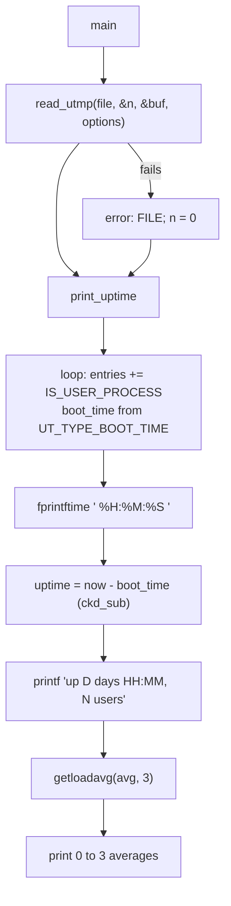

# `uptime`: how long the system has been running

Source: `src/uptime.c` (205 lines) · Tests: only the shared
`tests/help/help-version*.sh` · Manual: `info '(coreutils) uptime
invocation'`

`uptime` prints one line: the current time, the time since boot, the number
of logged-in users and the load averages. All the system-specific work is
in two gnulib modules. `readutmp` gives the boot time and the user
sessions, and `getloadavg` gives the load averages. Since 9.10, `uptime` is in `disabled_by_default_progs`, so it is built only with
`--enable-install-program=uptime` (see `NEWS`).

!!! warning "No `-p`, `-s` or `-V`"
    The `procps` version of `uptime` has `-p`/`--pretty` and `-s`/`--since`.
    Coreutils `uptime` has only `--help` and `--version`, and it accepts an
    optional FILE operand.

## Usage

| Form | Behaviour |
|---|---|
| `uptime` | `uptime (UTMP_FILE, READ_UTMP_CHECK_PIDS)`. Entries whose process no longer exists are ignored. |
| `uptime FILE` | `uptime (FILE, 0)`. Read another utmp-format file (for example `WTMP_FILE`) without the PID check. |
| `uptime A B` | `extra operand 'B'`, then a usage hint. |

Example output (format strings at `src/uptime.c:69-112`):

```text
 14:03:27  up 12 days  3:41,  4 users,  load average: 0.42, 0.37, 0.30
```

## Code map

| Function | Location | Role |
|---|---|---|
| `main` | `src/uptime.c:177` | Standard start-up. Choose the file and read options. |
| `uptime` | `:125` | `read_utmp()`, then `print_uptime()`, then `exit` with the higher of the two statuses. |
| `print_uptime` | `:40` | Count users, find the boot time, format the line. |

## How it works

The diagram shows the order of the work.



The main loop counts users and finds the boot time in the same pass
(`src/uptime.c:47-54`):

```c
idx_t entries = 0;
for (idx_t i = 0; i < n; i++)
  {
    STRUCT_UTMP const *this = &utmp_buf[i];
    entries += IS_USER_PROCESS (this);
    if (UT_TYPE_BOOT_TIME (this))
      boot_time = this->ut_ts.tv_sec;
  }
```

Things to note:

- **The boot time comes from utmp, not from `/proc/uptime` or `sysctl`.**
  A comment says gnulib's `readutmp` "is supposed to provide a BOOT_TIME
  entry on all platforms". On systems without a real utmp `BOOT_TIME`
  record, gnulib makes one up (for example from `/proc/uptime` on Linux or
  `kern.boottime` on BSD and macOS). When coreutils is configured with
  `--enable-systemd`, gnulib gets sessions from systemd in place of the
  utmp file.
- **Overflow-safe arithmetic.** `ckd_sub (&uptime, time_now, boot_time)`
  catches overflow. A negative result is treated as an error. When there
  is no boot time, the line shows `up ???? days ??:??,` and the exit status
  is 1.
- **Partial output on errors.** The program still prints what it can. If
  `localtime` fails, the time shows as ` ??:????  `.
- **Load averages.** `getloadavg` may return fewer than three values. The
  code prints however many it got. If it fails (`-1`), it prints the line
  without the load averages.
- On Linux, `--help` adds a note that processes in uninterruptible sleep
  count towards the load average. This is decided with `#ifdef __linux__`
  at compile time.

## Errors and exit status

`exit (MAX (read_utmp_status, print_uptime_status))`. The status is 1 if the
utmp file could not be read, if there was no boot time, or if the clock
could not be read or formatted.

## Platform notes

- `src/local.mk:312` and `:344` link `$(GETLOADAVG_LIBS)` and
  `$(READUTMP_LIB)`. The second is `-lsystemd` when gnulib uses systemd.
- `NEWS` has several entries for `uptime`: support for times after 2038,
  fixes for the user count on Android and OpenBSD, the removal of AM/PM
  from the time. With `--enable-systemd`, systemd session classes such as
  `greeter` and `lock-screen` are no longer counted as users.
- The gnulib fallbacks for the boot time are in `lib/readutmp.c` after
  `./bootstrap`. This page describes them only in outline. Check that file
  for the exact behaviour on your platform.

## Tests

None for this program alone, because the output depends on the machine.
`tests/help/` checks `--help` and `--version`.

## See also

- [who](who.md): `who -b` and `who -q` use the same `readutmp` data.

## Source code

`src/uptime.c:1`

```c
/* GNU's uptime.
   Copyright (C) 1992-2026 Free Software Foundation, Inc.

   This program is free software: you can redistribute it and/or modify
   it under the terms of the GNU General Public License as published by
   the Free Software Foundation, either version 3 of the License, or
   (at your option) any later version.

   This program is distributed in the hope that it will be useful,
   but WITHOUT ANY WARRANTY; without even the implied warranty of
   MERCHANTABILITY or FITNESS FOR A PARTICULAR PURPOSE.  See the
   GNU General Public License for more details.

   You should have received a copy of the GNU General Public License
   along with this program.  If not, see <https://www.gnu.org/licenses/>.  */

/* Created by hacking who.c by Kaveh Ghazi ghazi@caip.rutgers.edu.  */

#include <config.h>

#include <stdio.h>
#include <sys/types.h>

#include "system.h"

#include "long-options.h"
#include "quote.h"
#include "readutmp.h"
#include "fprintftime.h"

/* The official name of this program (e.g., no 'g' prefix).  */
#define PROGRAM_NAME "uptime"

#define AUTHORS \
  proper_name ("Joseph Arceneaux"), \
  proper_name ("David MacKenzie"), \
  proper_name ("Kaveh Ghazi")

static int
print_uptime (idx_t n, STRUCT_UTMP const *utmp_buf)
{
  int status = EXIT_SUCCESS;
  time_t boot_time = 0;

  /* Loop through all the utmp entries we just read and count up the valid
     ones, also in the process possibly gleaning boottime. */
  idx_t entries = 0;
  for (idx_t i = 0; i < n; i++)
    {
      STRUCT_UTMP const *this = &utmp_buf[i];
      entries += IS_USER_PROCESS (this);
      if (UT_TYPE_BOOT_TIME (this))
        boot_time = this->ut_ts.tv_sec;
    }
  /* The gnulib module 'readutmp' is supposed to provide a BOOT_TIME entry
     on all platforms.  */
  if (boot_time == 0)
    {
      error (0, errno, _("couldn't get boot time"));
      status = EXIT_FAILURE;
    }

  time_t time_now = time (NULL);
  struct tm *tmn = time_now == (time_t) -1 ? NULL : localtime (&time_now);
  /* procps' version of uptime also prints the seconds field, but
     previous versions of coreutils don't. */
  if (tmn)
    /* TRANSLATORS: This prints the current clock time. */
    fprintftime (stdout, _(" %H:%M:%S  "), tmn, (timezone_t) 0, 0);
  else
    {
      printf (_(" ??:????  "));
      status = EXIT_FAILURE;
    }

  intmax_t uptime;
  if (time_now == (time_t) -1 || boot_time == 0
      || ckd_sub (&uptime, time_now, boot_time) || uptime < 0)
    {
      printf (_("up ???? days ??:??,  "));
      status = EXIT_FAILURE;
    }
  else
    {
      intmax_t updays = uptime / 86400;
      int uphours = uptime % 86400 / 3600;
      int upmins = uptime % 86400 % 3600 / 60;
      if (0 < updays)
        printf (ngettext ("up %jd day %2d:%02d,  ",
                          "up %jd days %2d:%02d,  ",
                          select_plural (updays)),
                updays, uphours, upmins);
      else
        printf (_("up %2d:%02d,  "), uphours, upmins);
    }

  printf (ngettext ("%td user", "%td users", select_plural (entries)),
          entries);

  double avg[3];
  int loads = getloadavg (avg, 3);

  if (loads == -1)
    putchar ('\n');
  else
    {
      if (loads > 0)
        printf (_(",  load average: %.2f"), avg[0]);
      if (loads > 1)
        printf (", %.2f", avg[1]);
      if (loads > 2)
        printf (", %.2f", avg[2]);
      if (loads > 0)
        putchar ('\n');
    }

  return status;
}

/* Display the system uptime and the number of users on the system,
   according to utmp file FILENAME.  Use read_utmp OPTIONS to read the
   utmp file.  */

static _Noreturn void
uptime (char const *filename, int options)
{
  idx_t n_users;
  STRUCT_UTMP *utmp_buf;
  int read_utmp_status = (read_utmp (filename, &n_users, &utmp_buf, options) < 0
                          ? EXIT_FAILURE : EXIT_SUCCESS);
  if (read_utmp_status != EXIT_SUCCESS)
    {
      error (0, errno, "%s", quotef (filename));
      n_users = 0;
      utmp_buf = NULL;
    }

  int print_uptime_status = print_uptime (n_users, utmp_buf);
  exit (MAX (read_utmp_status, print_uptime_status));
}

void
usage (int status)
{
  if (status != EXIT_SUCCESS)
    emit_try_help ();
  else
    {
      printf (_("Usage: %s [OPTION]... [FILE]\n"), program_name);
      printf (_("\
Print the current time, the length of time the system has been up,\n\
the number of users on the system, and the average number of jobs\n\
in the run queue over the last 1, 5 and 15 minutes."));
#ifdef __linux__
      /* It would be better to introduce a configure test for this,
         but such a test is hard to write.  For the moment then, we
         have a hack which depends on the preprocessor used at compile
         time to tell us what the running kernel is.  Ugh.  */
      printf (_("  \
Processes in\n\
an uninterruptible sleep state also contribute to the load average.\n"));
#else
      printf (_("\n"));
#endif
      printf (_("\
If FILE is not specified, use %s.  %s as FILE is common.\n\
\n"),
              UTMP_FILE, WTMP_FILE);
      oputs (HELP_OPTION_DESCRIPTION);
      oputs (VERSION_OPTION_DESCRIPTION);
      emit_ancillary_info (PROGRAM_NAME);
    }
  exit (status);
}

int
main (int argc, char **argv)
{
  initialize_main (&argc, &argv);
  set_program_name (argv[0]);
  setlocale (LC_ALL, "");
  bindtextdomain (PACKAGE, LOCALEDIR);
  textdomain (PACKAGE);

  atexit (close_stdout);

  parse_gnu_standard_options_only (argc, argv, PROGRAM_NAME, PACKAGE_NAME,
                                   Version, true, usage, AUTHORS,
                                   (char const *) NULL);

  switch (argc - optind)
    {
    case 0:			/* uptime */
      uptime (UTMP_FILE, READ_UTMP_CHECK_PIDS);
      break;

    case 1:			/* uptime <utmp file> */
      uptime (argv[optind], 0);
      break;

    default:			/* lose */
      error (0, 0, _("extra operand %s"), quote (argv[optind + 1]));
      usage (EXIT_FAILURE);
    }
}
```
