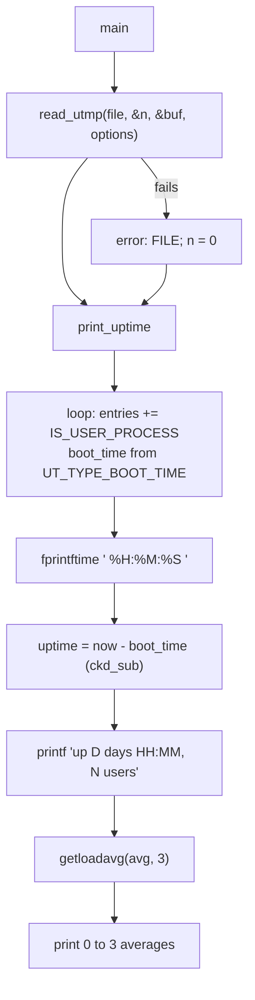

# `uptime`: how long the system has been running

Source: `src/uptime.c` (205 lines) · Tests: only the shared
`tests/help/help-version*.sh` · Manual: `info '(coreutils) uptime
invocation'`

`uptime` prints one line: the current time, the time since boot, the number
of logged-in users and the load averages. All the system-specific work is
in two gnulib modules. `readutmp` gives the boot time and the user
sessions, and `getloadavg` gives the load averages. Since 9.10, `uptime` is in `disabled_by_default_progs`, so it is built only with
`--enable-install-program=uptime` (see `NEWS`).

!!! warning "No `-p`, `-s` or `-V`"
    The `procps` version of `uptime` has `-p`/`--pretty` and `-s`/`--since`.
    Coreutils `uptime` has only `--help` and `--version`, and it accepts an
    optional FILE operand.

## Usage

| Form | Behaviour |
|---|---|
| `uptime` | `uptime (UTMP_FILE, READ_UTMP_CHECK_PIDS)`. Entries whose process no longer exists are ignored. |
| `uptime FILE` | `uptime (FILE, 0)`. Read another utmp-format file (for example `WTMP_FILE`) without the PID check. |
| `uptime A B` | `extra operand 'B'`, then a usage hint. |

Example output (format strings at `src/uptime.c:69-112`):

```text
 14:03:27  up 12 days  3:41,  4 users,  load average: 0.42, 0.37, 0.30
```

## Code map

| Function | Location | Role |
|---|---|---|
| `main` | `src/uptime.c:177` | Standard start-up. Choose the file and read options. |
| `uptime` | `:125` | `read_utmp()`, then `print_uptime()`, then `exit` with the higher of the two statuses. |
| `print_uptime` | `:40` | Count users, find the boot time, format the line. |

## How it works

The diagram shows the order of the work.



The main loop counts users and finds the boot time in the same pass
(`src/uptime.c:47-54`):

```c
idx_t entries = 0;
for (idx_t i = 0; i < n; i++)
  {
    STRUCT_UTMP const *this = &utmp_buf[i];
    entries += IS_USER_PROCESS (this);
    if (UT_TYPE_BOOT_TIME (this))
      boot_time = this->ut_ts.tv_sec;
  }
```

Things to note:

- **The boot time comes from utmp, not from `/proc/uptime` or `sysctl`.**
  A comment says gnulib's `readutmp` "is supposed to provide a BOOT_TIME
  entry on all platforms". On systems without a real utmp `BOOT_TIME`
  record, gnulib makes one up (for example from `/proc/uptime` on Linux or
  `kern.boottime` on BSD and macOS). When coreutils is configured with
  `--enable-systemd`, gnulib gets sessions from systemd in place of the
  utmp file.
- **Overflow-safe arithmetic.** `ckd_sub (&uptime, time_now, boot_time)`
  catches overflow. A negative result is treated as an error. When there
  is no boot time, the line shows `up ???? days ??:??,` and the exit status
  is 1.
- **Partial output on errors.** The program still prints what it can. If
  `localtime` fails, the time shows as ` ??:????  `.
- **Load averages.** `getloadavg` may return fewer than three values. The
  code prints however many it got. If it fails (`-1`), it prints the line
  without the load averages.
- On Linux, `--help` adds a note that processes in uninterruptible sleep
  count towards the load average. This is decided with `#ifdef __linux__`
  at compile time.

## Errors and exit status

`exit (MAX (read_utmp_status, print_uptime_status))`. The status is 1 if the
utmp file could not be read, if there was no boot time, or if the clock
could not be read or formatted.

## Platform notes

- `src/local.mk:312` and `:344` link `$(GETLOADAVG_LIBS)` and
  `$(READUTMP_LIB)`. The second is `-lsystemd` when gnulib uses systemd.
- `NEWS` has several entries for `uptime`: support for times after 2038,
  fixes for the user count on Android and OpenBSD, the removal of AM/PM
  from the time. With `--enable-systemd`, systemd session classes such as
  `greeter` and `lock-screen` are no longer counted as users.
- The gnulib fallbacks for the boot time are in `lib/readutmp.c` after
  `./bootstrap`. This page describes them only in outline. Check that file
  for the exact behaviour on your platform.

## Tests

None for this program alone, because the output depends on the machine.
`tests/help/` checks `--help` and `--version`.

## See also

- [who](who.md): `who -b` and `who -q` use the same `readutmp` data.
