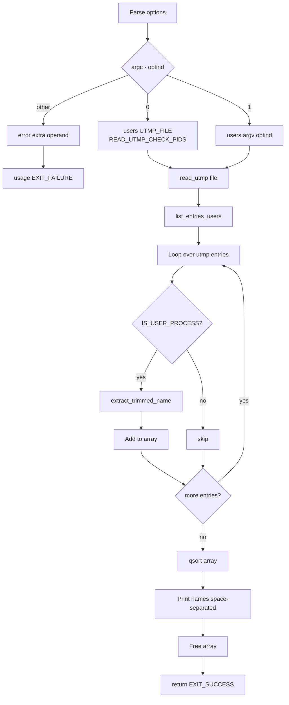

# `users`: print logged-in users

Source: `src/users.c` (147 lines) · Tests: see `who` tests ·
Manual: `info '(coreutils) users invocation'`

`users` prints a space-separated list of users currently logged in, according
to the utmp file (default: `/var/run/utmp`). It reads the utmp entries, filters
for user processes, extracts and trims user names, sorts them, and prints the
unique list.

## Options

No options other than `--help` and `--version`. Uses `parse_gnu_standard_options_only`
(`src/users.c:127-129`).

## Code map

|| Function | Location | Role |
||---|---|---|
|| `main` | `src/users.c:117` | Parse arguments, call `users` with default or specified file. |
|| `users` | `:81` | Read utmp file, call `list_entries_users`. |
|| `list_entries_users` | `:44` | Filter user processes, extract names, sort, print. |
|| `userid_compare` | `:36` | qsort comparison function for user names. |
|| `usage` | `:95` | Help text. |

## How it works

The diagram shows the main flow.

### Reading utmp

`users` calls the gnulib `read_utmp` function with the utmp file path
(`src/users.c:86-88`). For the default file, it adds `READ_UTMP_CHECK_PIDS` to
verify that processes are still running.

### Filtering and sorting

`list_entries_users` (`src/users.c:44-76`) loops through the utmp buffer:

1. Checks `IS_USER_PROCESS` to filter for user process entries
2. Calls `extract_trimmed_name` (gnulib) to get the user name
3. Stores names in an array
4. Sorts the array with `qsort` using `userid_compare`
5. Prints names space-separated

## Platform notes

- `UTMP_FILE` and `WTMP_FILE` are configure-time defaults (typically
  `/var/run/utmp` and `/var/log/wtmp`)
- `STRUCT_UTMP` and `IS_USER_PROCESS` are gnulib abstractions for platform
  differences in utmp formats

## Errors and exit status

- Extra operand: `error (0, 0, ...)` then `usage (EXIT_FAILURE)`
- `read_utmp` failure: `error (EXIT_FAILURE, errno, ...)`
- Write failure: handled by `atexit (close_stdout)`

## Tests

No dedicated `users` tests. Functionality is covered by `who` tests.

## See also

- [who](who.md) (print who is logged in with more detail)
