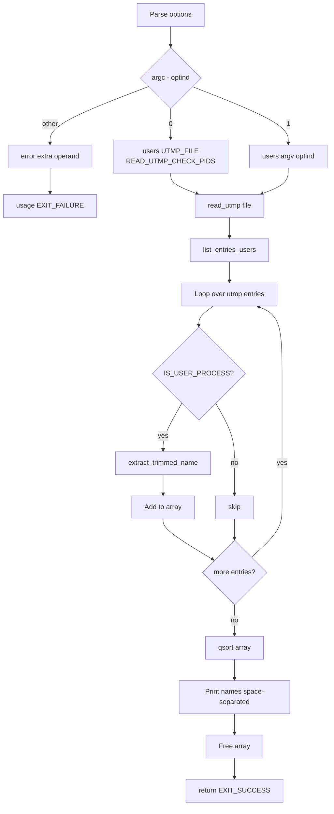

# `users`: print logged-in users

Source: `src/users.c` (147 lines) · Tests: see `who` tests ·
Manual: `info '(coreutils) users invocation'`

`users` prints a space-separated list of users currently logged in, according
to the utmp file (default: `/var/run/utmp`). It reads the utmp entries, filters
for user processes, extracts and trims user names, sorts them, and prints the
unique list.

## Options

No options other than `--help` and `--version`. Uses `parse_gnu_standard_options_only`
(`src/users.c:127-129`).

## Code map

|| Function | Location | Role |
||---|---|---|
|| `main` | `src/users.c:117` | Parse arguments, call `users` with default or specified file. |
|| `users` | `:81` | Read utmp file, call `list_entries_users`. |
|| `list_entries_users` | `:44` | Filter user processes, extract names, sort, print. |
|| `userid_compare` | `:36` | qsort comparison function for user names. |
|| `usage` | `:95` | Help text. |

## How it works

The diagram shows the main flow.



### Reading utmp

`users` calls the gnulib `read_utmp` function with the utmp file path
(`src/users.c:86-88`). For the default file, it adds `READ_UTMP_CHECK_PIDS` to
verify that processes are still running.

### Filtering and sorting

`list_entries_users` (`src/users.c:44-76`) loops through the utmp buffer:

1. Checks `IS_USER_PROCESS` to filter for user process entries
2. Calls `extract_trimmed_name` (gnulib) to get the user name
3. Stores names in an array
4. Sorts the array with `qsort` using `userid_compare`
5. Prints names space-separated

## Platform notes

- `UTMP_FILE` and `WTMP_FILE` are configure-time defaults (typically
  `/var/run/utmp` and `/var/log/wtmp`)
- `STRUCT_UTMP` and `IS_USER_PROCESS` are gnulib abstractions for platform
  differences in utmp formats

## Errors and exit status

- Extra operand: `error (0, 0, ...)` then `usage (EXIT_FAILURE)`
- `read_utmp` failure: `error (EXIT_FAILURE, errno, ...)`
- Write failure: handled by `atexit (close_stdout)`

## Tests

No dedicated `users` tests. Functionality is covered by `who` tests.

## See also

- [who](who.md) (print who is logged in with more detail)

## Source code

`src/users.c:1`

```c
/* GNU's users.
   Copyright (C) 1992-2026 Free Software Foundation, Inc.

   This program is free software: you can redistribute it and/or modify
   it under the terms of the GNU General Public License as published by
   the Free Software Foundation, either version 3 of the License, or
   (at your option) any later version.

   This program is distributed in the hope that it will be useful,
   but WITHOUT ANY WARRANTY; without even the implied warranty of
   MERCHANTABILITY or FITNESS FOR A PARTICULAR PURPOSE.  See the
   GNU General Public License for more details.

   You should have received a copy of the GNU General Public License
   along with this program.  If not, see <https://www.gnu.org/licenses/>.  */

/* Written by jla; revised by djm */

#include <config.h>
#include <stdio.h>

#include <sys/types.h>
#include "system.h"

#include "long-options.h"
#include "quote.h"
#include "readutmp.h"

/* The official name of this program (e.g., no 'g' prefix).  */
#define PROGRAM_NAME "users"

#define AUTHORS \
  proper_name ("Joseph Arceneaux"), \
  proper_name ("David MacKenzie")

static int
userid_compare (const void *v_a, const void *v_b)
{
  char **a = (char **) v_a;
  char **b = (char **) v_b;
  return strcmp (*a, *b);
}

static void
list_entries_users (idx_t n, STRUCT_UTMP const *this)
{
  char **u = xinmalloc (n, sizeof *u);
  idx_t n_entries = 0;

  while (n--)
    {
      if (IS_USER_PROCESS (this))
        {
          char *trimmed_name;

          trimmed_name = extract_trimmed_name (this);

          u[n_entries] = trimmed_name;
          ++n_entries;
        }
      this++;
    }

  qsort (u, n_entries, sizeof (u[0]), userid_compare);

  for (idx_t i = 0; i < n_entries; i++)
    {
      char c = (i < n_entries - 1 ? ' ' : '\n');
      fputs (u[i], stdout);
      putchar (c);
    }

  for (idx_t i = 0; i < n_entries; i++)
    free (u[i]);
  free (u);
}

/* Display a list of users on the system, according to utmp file FILENAME.
   Use read_utmp OPTIONS to read FILENAME.  */

static void
users (char const *filename, int options)
{
  idx_t n_users;
  STRUCT_UTMP *utmp_buf;
  options |= READ_UTMP_USER_PROCESS;
  if (read_utmp (filename, &n_users, &utmp_buf, options) != 0)
    error (EXIT_FAILURE, errno, "%s", quotef (filename));

  list_entries_users (n_users, utmp_buf);

  free (utmp_buf);
}

void
usage (int status)
{
  if (status != EXIT_SUCCESS)
    emit_try_help ();
  else
    {
      printf (_("Usage: %s [OPTION]... [FILE]\n"), program_name);
      printf (_("\
Output who is currently logged in according to FILE.\n\
If FILE is not specified, use %s.  %s as FILE is common.\n\
\n\
"),
              UTMP_FILE, WTMP_FILE);
      oputs (HELP_OPTION_DESCRIPTION);
      oputs (VERSION_OPTION_DESCRIPTION);
      emit_ancillary_info (PROGRAM_NAME);
    }
  exit (status);
}

int
main (int argc, char **argv)
{
  initialize_main (&argc, &argv);
  set_program_name (argv[0]);
  setlocale (LC_ALL, "");
  bindtextdomain (PACKAGE, LOCALEDIR);
  textdomain (PACKAGE);

  atexit (close_stdout);

  parse_gnu_standard_options_only (argc, argv, PROGRAM_NAME, PACKAGE_NAME,
                                   Version, true, usage, AUTHORS,
                                   (char const *) NULL);

  switch (argc - optind)
    {
    case 0:			/* users */
      users (UTMP_FILE, READ_UTMP_CHECK_PIDS);
      break;

    case 1:			/* users <utmp file> */
      users (argv[optind], 0);
      break;

    default:			/* lose */
      error (0, 0, _("extra operand %s"), quote (argv[optind + 1]));
      usage (EXIT_FAILURE);
    }

  return EXIT_SUCCESS;
}
```
