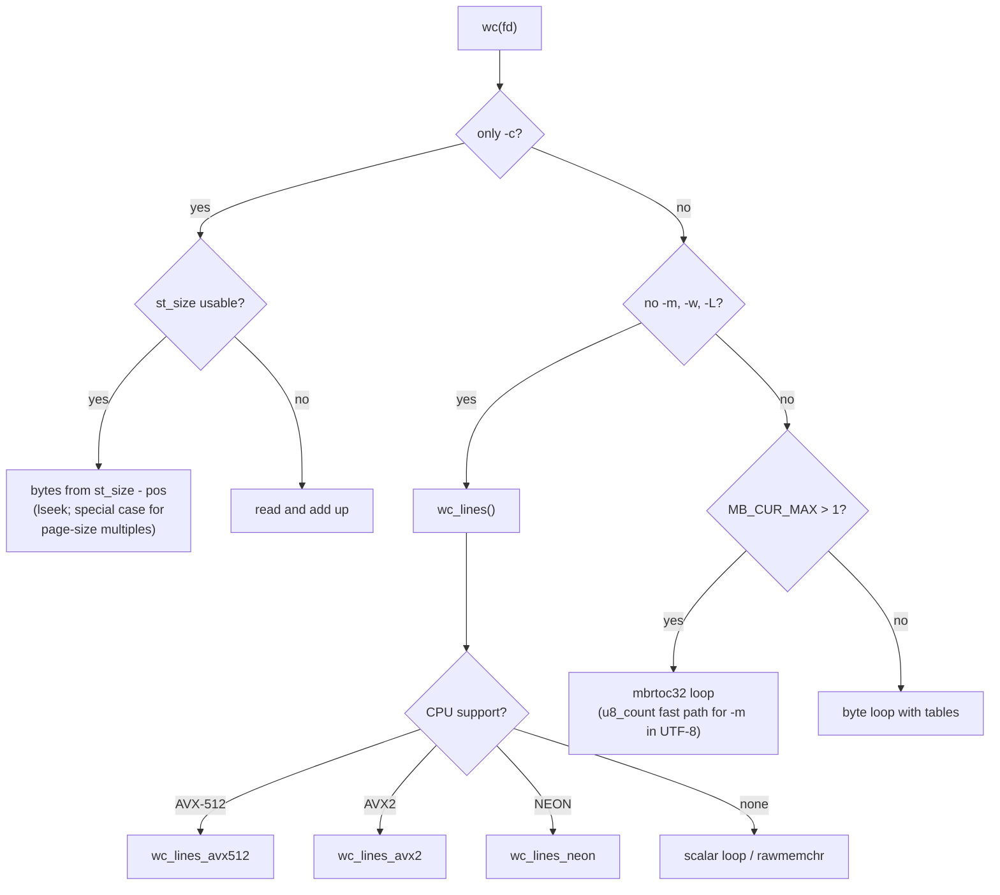

# `wc`: count lines, words and bytes

Source: `src/wc.c` (1071 lines), `src/wc.h`, `src/wc_avx2.c`,
`src/wc_avx512.c`, `src/wc_neon.c` · Tests: `tests/wc/` · Manual:
`info '(coreutils) wc invocation'`

`wc` counts lines, words, characters, bytes and the maximum display width
of a line. `wc()` has four separate loops and uses the cheapest one that
can produce the counts that were asked for:

1. **Bytes only:** use `st_size` and `lseek` when the size can be trusted.
   Otherwise read and count.
2. **Lines (and bytes) only:** `wc_lines()`, with SIMD versions for AVX2,
   AVX-512 and NEON chosen at run time.
3. **Words, characters or max line length in a multibyte locale:** a decode
   loop using `mbrtoc32`, with a fast path for ASCII and for UTF-8.
4. **The same in a single-byte locale:** a byte loop with lookup tables.

## Options

The table lists `longopts[]` (`src/wc.c:106-119`) and the short-option
string `"clLmw"`.

| Option | Variable |
|---|---|
| `-c`, `--bytes` | `print_bytes` |
| `-m`, `--chars` | `print_chars` |
| `-l`, `--lines` | `print_lines` |
| `-w`, `--words` | `print_words` |
| `-L`, `--max-line-length` | `print_linelength` |
| `--files0-from=F` | Read NUL-separated file names from F (`-` means stdin). Cannot be combined with file operands. |
| `--total=auto\|always\|only\|never` | When to print the `total` line. `only` prints just the totals, with no label. |
| `--debug` | Report which SIMD code was chosen, for example `using avx2 hardware support`. |

With none of `-c -m -l -w -L`, `wc` prints lines, words and bytes.

## Code map

| Function | Location | Role |
|---|---|---|
| `main` | `src/wc.c:817` | Options, the `wc_isprint`/`wc_isspace` tables, the file list (`argv` or `--files0-from` with `argv_iter`), column width, totals. |
| `wc_file` | `:721` | Open the file (or use stdin) and call `wc`. |
| `wc` | `:374` | Choose a loop and count. Add to the totals, checking for overflow. |
| `wc_lines` | `:307` | Count newlines (and bytes). Uses SIMD if available. |
| `wc_lines_avx2`, `wc_lines_avx512`, `wc_lines_neon` | `src/wc_avx2.c`, … | SIMD newline counting. Each is in its own small library built with special compiler flags. |
| `avx2_supported`, `avx512_supported`, `neon_supported` | `:141-181` | Run-time CPU checks (`cpu_supports`, `cpu_may_support`). |
| `get_input_fstatus` | `:757` | `stat` the inputs early, to work out the column width. |
| `compute_number_width` | `:784` | Width from the sum of regular file sizes. At least 7 if any input is not a regular file. |
| `write_counts` | `:263` | Print the columns that were asked for, in the fixed order: lines, words, chars, bytes, max length. |

## How it works

The diagram shows how `wc()` chooses a loop
(`src/wc.c:412-699`).



### Bytes only

To count bytes, `wc` does not need to read a regular file
(`src/wc.c:412-472`). It uses `st_size` minus the current offset, so
`(dd skip=... count=0; wc -c) < file` gives the right answer. Files whose
size is an exact multiple of the page size are treated with care, because
`/proc` and `/sys` files often report one page. For these, `wc` seeks to
one `st_blksize` before the end and reads the rest. `tests/wc/wc-proc.sh`
and `tests/wc/page-size.sh` cover this.

In a single-byte locale, `-m` is the same as `-c` (`count_bytes =
print_bytes || print_chars`), so it takes this path too.

### Lines

The scalar `wc_lines` reads `IO_BUFSIZE` blocks. If the average line in
the last block was shorter than 15 bytes, it counts `'\n'` with a simple
loop. Otherwise it uses `rawmemchr`, with a `'\n'` sentinel after the data.
A `FIXME` says the value 15 was measured in 2015 and should be checked
again.

The AVX2 version (`src/wc_avx2.c`) compares 32 bytes at a time with
`_mm256_cmpeq_epi8` and adds `__builtin_popcount` of the
`_mm256_movemask_epi8` mask:

```c
while (bytes_read >= 32)
  {
     __m256i to_match = _mm256_load_si256 (datap);
     __m256i matches = _mm256_cmpeq_epi8 (to_match, endlines);
     int mask = _mm256_movemask_epi8 (matches);
     lines += __builtin_popcount (mask);
     datap += 1;
     bytes_read -= 32;
  }
```

`configure` decides whether each SIMD file can be compiled
(`USE_AVX2_WC_LINECOUNT` and so on). The CPU check happens once, on the
first call, and the result is kept in a `static signed char`.

### Words and characters

- A **word** starts at each change from white space to non-white space
  (`words += !in_word & in_word2`).
- In a multibyte locale, a byte that does not decode counts as a byte but
  not a character, and it is treated as part of a word. A long comment
  explains this choice (`src/wc.c:562-569`).
- Non-breaking spaces (`c32isnbspace`) count as white space unless
  `POSIXLY_CORRECT` is set (`maybe_c32isnbspace`). `tests/wc/wc-nbsp.sh`
  covers this.
- For `-m` alone in UTF-8, `u8_count` counts characters in bulk, at most
  once per buffer.
- An incomplete multibyte character at the end of a buffer is moved to the
  start of the buffer before the next read (`prev`).
- `-L` uses tabs to the next multiple of 8, `c32width` for wide characters,
  and resets at `\n`, `\r` and `\f`.

## Errors and exit status

A file that cannot be opened or read is reported, and the exit status is 1.
If a total overflows `intmax_t`, it is printed as `UINTMAX_MAX` with an
`EOVERFLOW` message (`total lines` and so on).

## Tests

| File | Covers |
|---|---|
| `tests/wc/wc.pl` | The main table of cases. |
| `tests/wc/wc-cpu.sh` | The same results with and without each SIMD path. SIMD is turned off with `GLIBC_TUNABLES=glibc.cpu.hwcaps=-AVX2,...`. |
| `tests/wc/wc-files0-from.pl`, `wc-files0.sh` | `--files0-from`. |
| `tests/wc/wc-total.sh` | `--total` modes and overflow. |
| `tests/wc/wc-proc.sh`, `page-size.sh` | `/proc` files and page-size file lengths. |
| `tests/wc/wc-nbsp.sh` | Non-breaking spaces. |
| `tests/wc/mb-non-utf8.sh`, `wc-sjis.sh` | Multibyte locales other than UTF-8. |
| `tests/wc/wc-parallel.sh` | Each count line is printed in one write, so lines from several `wc` processes do not mix. |

## See also

- [cksum](cksum.md): the other program with SIMD paths chosen at run time.
- [Source layout](../overview/source-layout.md#how-a-programs-sources-are-listed)
  for how the SIMD libraries are built.
