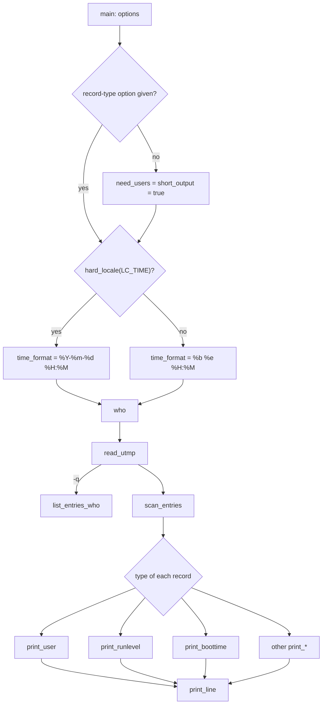

# `who`: show who is logged on

Source: `src/who.c` (846 lines) · Tests: none for this program alone (see
[Tests](#tests)) · Manual: `info '(coreutils) who invocation'`

`who` reads the login records (utmp) through gnulib's `readutmp` module. It
prints one line for each record that matches the selected types. Most of
the file is formatting: choosing columns, finding the idle time from the
terminal's access time, and showing the remote host. `who` is in
`build_if_possible_progs`, so it is built only where `configure` finds utmp
support.

## Options

The table lists `longopts[]` (`src/who.c:154-174`) and the short-option
string `"abdlmpqrstuwHT"`.

| Option | Flags set | Record type shown |
|---|---|---|
| `-a`, `--all` | All `need_*` flags, `include_mesg`, `include_idle`, `include_exit` | Everything (same as `-b -d --login -p -r -t -T -u`) |
| `-b`, `--boot` | `need_boottime` | `BOOT_TIME` |
| `-d`, `--dead` | `need_deadprocs`, `include_idle`, `include_exit` | `DEAD_PROCESS` |
| `-l`, `--login` | `need_login`, `include_idle` | `LOGIN_PROCESS` (shown as `LOGIN`) |
| `-p`, `--process` | `need_initspawn` | `INIT_PROCESS` |
| `-r`, `--runlevel` | `need_runlevel`, `include_idle` | `RUN_LVL` |
| `-t`, `--time` | `need_clockchange` | `NEW_TIME` |
| `-u`, `--users` | `need_users`, `include_idle` | `USER_PROCESS`, with the IDLE column |
| `-q`, `--count` | `short_list` | User names and `# users=N` only |
| `-s`, `--short` | `short_output` | Only NAME, LINE, TIME (and COMMENT). This is the default. |
| `-H`, `--heading` | `include_heading` | Print a heading line |
| `-T`, `-w`, `--mesg`, `--message`, `--writable` | `include_mesg` | Add `+`, `-` or `?` for the `mesg` state |
| `-m` | `my_line_only` | Only the terminal on stdin. Same as `who am i`. |
| `--lookup` | `do_lookup` | Use DNS to get the full name of `ut_host` (`canon_host`). |

If no option that chooses record types is given (`assumptions` stays
`true`), `who` acts as if `-u -s` were given, without the IDLE column. `-d`
and `-a` set `include_exit`, which turns `short_output` off again.

### Operands

| Operands | Effect (`src/who.c:826-843`) |
|---|---|
| none | `who (UTMP_FILE, READ_UTMP_CHECK_PIDS)`: skip entries whose process has gone. |
| `FILE` | `who (FILE, 0)`, for example `who /var/log/wtmp`. |
| any two words (`who am i`, `who mom likes`) | Set `my_line_only`, then read `UTMP_FILE`. |
| three or more | `extra operand` error. |

## Code map

| Function | Location | Role |
|---|---|---|
| `main` | `src/who.c:698` | Options, the default flags, the time format, the operand cases. |
| `who` | `:606` | `read_utmp`, then `list_entries_who` (`-q`) or `scan_entries`. |
| `scan_entries` | `:555` | Go through the records. Send each to a `print_*` function with an `if / else if` chain. |
| `print_user` | `:312` | `USER_PROCESS`: `fstatat` on the tty for the mesg state and idle time, then format the host. |
| `print_line` | `:227` | Build one fixed-width line with `xasprintf` and remove trailing spaces. |
| `idle_string` | `:180` | `"  .  "` (idle under 1 minute), `HH:MM`, or `" old "`. |
| `time_string` | `:209` | `strftime` with `time_format`. |
| `is_tty_writable` | `:296` | Group-write bit on the tty. If `TTY_GROUP_NAME` is defined, the tty's group must also be that group. |
| `print_boottime`, `print_deadprocs`, `print_login`, `print_initspawn`, `print_clockchange`, `print_runlevel` | `:426-518` | One for each record type. |
| `list_entries_who` | `:523` | Output for `-q`. |

## How it works

The diagram shows the main path through the program.



### Columns

`print_line` builds this format string (`src/who.c:256-278`). Columns that
are turned off become empty strings:

```text
%-8s  %s     %-12s  %-*s  %s     %s    %-8s     %s
NAME  [mesg] LINE   TIME  [IDLE] [PID] COMMENT  [EXIT]
```

The header comment at the top of the file gives the same layout. The time
format depends on the locale. With `hard_locale (LC_TIME)` (any locale
other than C or POSIX) it is `%Y-%m-%d %H:%M`. In the C locale it is the
traditional `%b %e %H:%M` (`src/who.c:815-824`).

### Idle time and mesg state

`print_user` finds the terminal device from `ut_line`. A name with a space
is cut after the space, and a relative name is opened relative to an
`O_PATHSEARCH` descriptor for `/dev` that is opened once. Then it calls
`fstatat`:

- `st_atime` is the last input time, so `idle_string (st_atime, boottime)`
  gives the IDLE column. Times before the last boot, in the future, or more
  than 24 hours ago show as `old`.
- The group-write bit gives `+` or `-`. If `fstatat` fails, the result is
  `?`.

### Remote host

When `ut_host` is set, `print_user` splits off an X display after `:`. With
`--lookup` it calls `canon_host()` (gnulib, using `getaddrinfo`
`AI_CANONNAME`) and prints `(host:display)` or `(host)`. The buffer is
`static`, and `xpalloc` grows it.

### `who am i`

With `-m` or two operands, `scan_entries` calls `ttyname (STDIN_FILENO)`,
removes `/dev/`, and keeps only records whose `ut_line` ends with that name.
If stdin is not a terminal, it prints nothing and exits with status 0.

## Errors and exit status

If `read_utmp` fails, `who` prints the error with the file name and exits
with status 1. Otherwise the status is 0, even if nothing was printed.

## Tests

No test in `tests/` runs `who` as its main subject, because the output
depends on the machine. `tests/help/help-version.sh` checks `--help` and
`--version`. `tests/rm/fail-2eperm.sh` uses `who` only to find a user
name.

## See also

- [uptime](uptime.md) uses the same `readutmp` records.
- `pinky` and `users` (`src/pinky.c`, `src/users.c`) are other readers of
  the same data.
