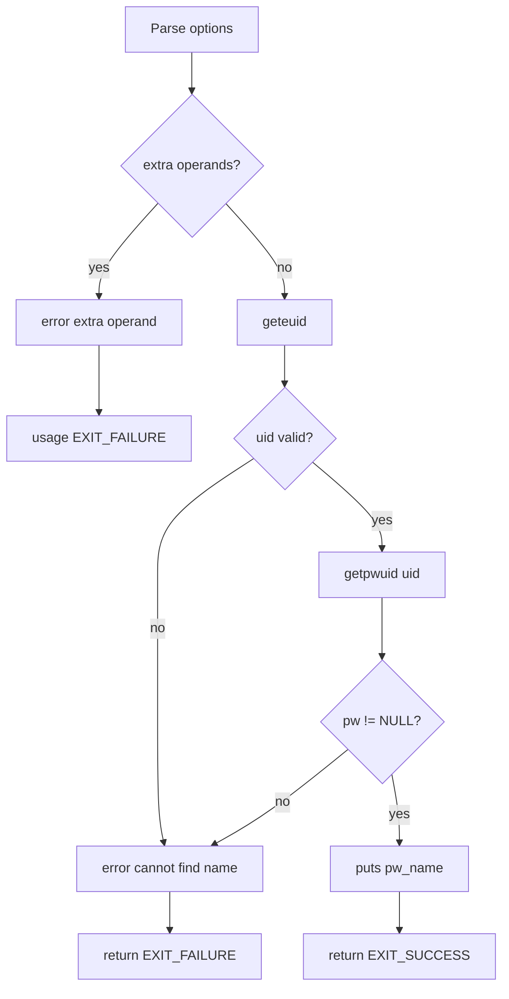

# `whoami`: print effective user name

Source: `src/whoami.c` (86 lines) · Tests: see `id` tests ·
Manual: `info '(coreutils) whoami invocation'`

`whoami` prints the user name associated with the current effective user ID.
It is equivalent to `id -un`. The program calls `geteuid` to get the effective
UID, then `getpwuid` to look up the user name.

## Options

No options other than `--help` and `--version`. Uses `parse_gnu_standard_options_only`
(`src/whoami.c:68-70`).

## Code map

|| Function | Location | Role |
||---|---|---|
|| `main` | `src/whoami.c:56` | Get effective UID, look up user name, print it. |
|| `usage` | `:35` | Help text. |

## How it works

The diagram shows the simple flow.

### User lookup

`main` calls `geteuid` to get the effective user ID (`src/whoami.c:79`), then
`getpwuid` to look up the password entry (`src/whoami.c:80`). If `getpwuid`
fails (returns NULL or `geteuid` failed), it reports an error and exits.

## Platform notes

None significant. Relies on POSIX `geteuid` and `getpwuid`.

## Errors and exit status

- Extra operand: `error (0, 0, ...)` then `usage (EXIT_FAILURE)`
- Cannot find name for user ID: `error (EXIT_FAILURE, errno, ...)`
- Write failure: handled by `atexit (close_stdout)`

## Tests

No dedicated `whoami` tests. Functionality is covered by `id` tests.

## See also

- [id](id.md) (print user and group IDs)
- [groups](groups.md) (print group names)
