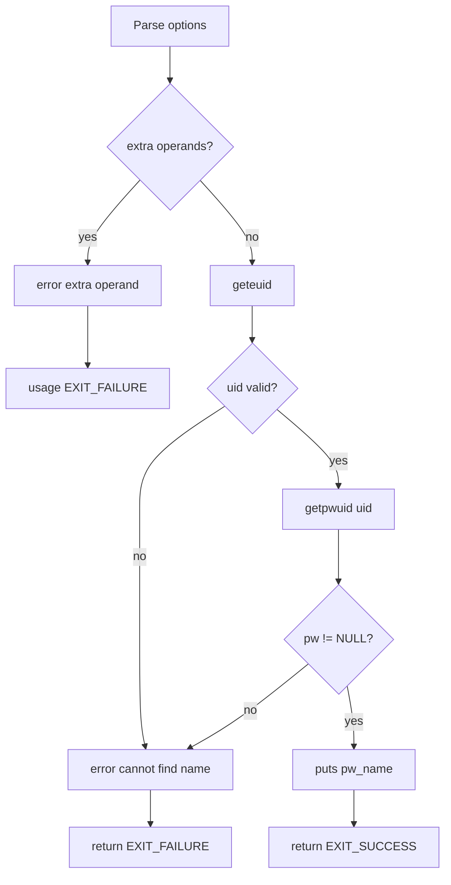

# `whoami`: print effective user name

Source: `src/whoami.c` (86 lines) · Tests: see `id` tests ·
Manual: `info '(coreutils) whoami invocation'`

`whoami` prints the user name associated with the current effective user ID.
It is equivalent to `id -un`. The program calls `geteuid` to get the effective
UID, then `getpwuid` to look up the user name.

## Options

No options other than `--help` and `--version`. Uses `parse_gnu_standard_options_only`
(`src/whoami.c:68-70`).

## Code map

|| Function | Location | Role |
||---|---|---|
|| `main` | `src/whoami.c:56` | Get effective UID, look up user name, print it. |
|| `usage` | `:35` | Help text. |

## How it works

The diagram shows the simple flow.



### User lookup

`main` calls `geteuid` to get the effective user ID (`src/whoami.c:79`), then
`getpwuid` to look up the password entry (`src/whoami.c:80`). If `getpwuid`
fails (returns NULL or `geteuid` failed), it reports an error and exits.

## Platform notes

None significant. Relies on POSIX `geteuid` and `getpwuid`.

## Errors and exit status

- Extra operand: `error (0, 0, ...)` then `usage (EXIT_FAILURE)`
- Cannot find name for user ID: `error (EXIT_FAILURE, errno, ...)`
- Write failure: handled by `atexit (close_stdout)`

## Tests

No dedicated `whoami` tests. Functionality is covered by `id` tests.

## See also

- [id](id.md) (print user and group IDs)
- [groups](groups.md) (print group names)

## Source code

`src/whoami.c:1`

```c
/* whoami -- print effective userid

   Copyright (C) 1989-2026 Free Software Foundation, Inc.

   This program is free software: you can redistribute it and/or modify
   it under the terms of the GNU General Public License as published by
   the Free Software Foundation, either version 3 of the License, or
   (at your option) any later version.

   This program is distributed in the hope that it will be useful,
   but WITHOUT ANY WARRANTY; without even the implied warranty of
   MERCHANTABILITY or FITNESS FOR A PARTICULAR PURPOSE.  See the
   GNU General Public License for more details.

   You should have received a copy of the GNU General Public License
   along with this program.  If not, see <https://www.gnu.org/licenses/>.  */

/* Equivalent to 'id -un'. */
/* Written by Richard Mlynarik. */

#include <config.h>
#include <stdio.h>
#include <sys/types.h>
#include <pwd.h>

#include "system.h"
#include "long-options.h"
#include "quote.h"

/* The official name of this program (e.g., no 'g' prefix).  */
#define PROGRAM_NAME "whoami"

#define AUTHORS proper_name ("Richard Mlynarik")

void
usage (int status)
{
  if (status != EXIT_SUCCESS)
    emit_try_help ();
  else
    {
      printf (_("Usage: %s [OPTION]...\n"), program_name);
      fputs (_("\
Print the user name associated with the current effective user ID.\n\
Same as id -un.\n\
\n\
"), stdout);
      oputs (HELP_OPTION_DESCRIPTION);
      oputs (VERSION_OPTION_DESCRIPTION);
      emit_ancillary_info (PROGRAM_NAME);
    }
  exit (status);
}

int
main (int argc, char **argv)
{
  uid_t NO_UID = -1;

  initialize_main (&argc, &argv);
  set_program_name (argv[0]);
  setlocale (LC_ALL, "");
  bindtextdomain (PACKAGE, LOCALEDIR);
  textdomain (PACKAGE);

  atexit (close_stdout);

  parse_gnu_standard_options_only (argc, argv, PROGRAM_NAME, PACKAGE_NAME,
                                   Version, true, usage, AUTHORS,
                                   (char const *) NULL);

  if (optind != argc)
    {
      error (0, 0, _("extra operand %s"), quote (argv[optind]));
      usage (EXIT_FAILURE);
    }

  errno = 0;
  uid_t uid = geteuid ();
  struct passwd *pw = uid == NO_UID && errno ? NULL : getpwuid (uid);
  if (!pw)
    error (EXIT_FAILURE, errno, _("cannot find name for user ID %ju"),
           (uintmax_t) uid);
  puts (pw->pw_name);
  return EXIT_SUCCESS;
}
```
