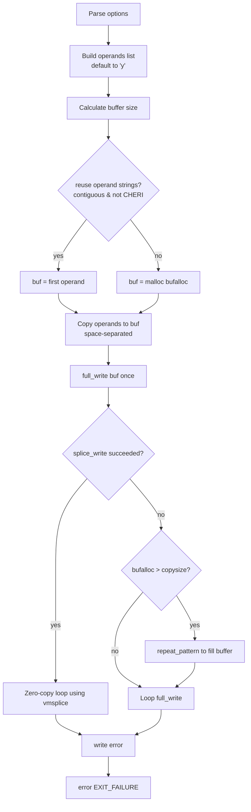

# `yes`: output a string repeatedly

Source: `src/yes.c` (270 lines) · Tests: `tests/misc/yes.sh` ·
Manual: `info '(coreutils) yes invocation'`

`yes` repeatedly outputs a line with the specified string(s), or `y` if no
arguments are given. It optimizes output by building a buffer once and repeating
it, and on Linux it can use `vmsplice`/`splice` for zero-copy I/O to pipes.

## Options

No options other than `--help` and `--version`. Uses `parse_gnu_standard_options_only`
(`src/yes.c:200-202`).

## Code map

|| Function | Location | Role |
||---|---|---|
|| `main` | `src/yes.c:190` | Build output buffer, try splice I/O, loop writing until error. |
|| `repeat_pattern` | `:65` | Fill buffer by doubling the pattern (exponential fill). |
|| `splice_write` | `:101` | Zero-copy I/O using vmsplice/splice (Linux only). |
|| `pipe_splice_size` | `:85` | Enlarge pipe and calculate optimal splice buffer size. |
|| `usage` | `:38` | Help text. |

## How it works

The diagram shows the main flow.

### Buffer construction

`main` builds a single buffer containing the output line
(`src/yes.c:204-250`). If the operand strings are contiguous in memory and not
on CHERI, it reuses them directly to avoid allocation. Otherwise, it allocates a
buffer and copies the operands. The minimum buffer size is `BUFSIZ` for
performance.

### Pattern repetition

`repeat_pattern` (`src/yes.c:65-76`) fills a buffer by repeatedly copying the
pattern, doubling the copy size each iteration for exponential fill. This is
used to expand the buffer to its full allocated size.

### Splice I/O

On Linux with `HAVE_SPLICE`, `splice_write` (`src/yes.c:101-187`) attempts
zero-copy I/O:

1. If stdout is a pipe, enlarge it and use 1/4 of its capacity as the transfer
   size
2. If stdout is not a pipe, create an intermediate pipe
3. Allocate a page-aligned buffer with `alignalloc`
4. Fill it with the repeated pattern
5. Use `vmsplice` with `SPLICE_F_GIFT` (for full pages) to transfer data to the
   pipe without copying
6. For non-pipe output, `splice` from the intermediate pipe to stdout

The `SPLICE_F_GIFT` flag tells the kernel the pages will not be modified, allowing
it to take references instead of copying.

## Platform notes

- Splice I/O is Linux-only (`#if HAVE_SPLICE`)
- CHERI capability bounds prevent string reuse (`src/yes.c:231-234`)
- `increase_pipe_size` is a gnulib function for Linux pipe capacity

## Errors and exit status

- Write failure: `error (0, errno, ...)` then `main_exit (EXIT_FAILURE)`
- Invalid option: handled by `parse_gnu_standard_options_only`

## Tests

|| File | Covers |
||---|---|
|| `tests/misc/yes.sh` | Basic functionality, termination with SIGPIPE. |

## See also

- [printf](printf.md) (for formatted output)
