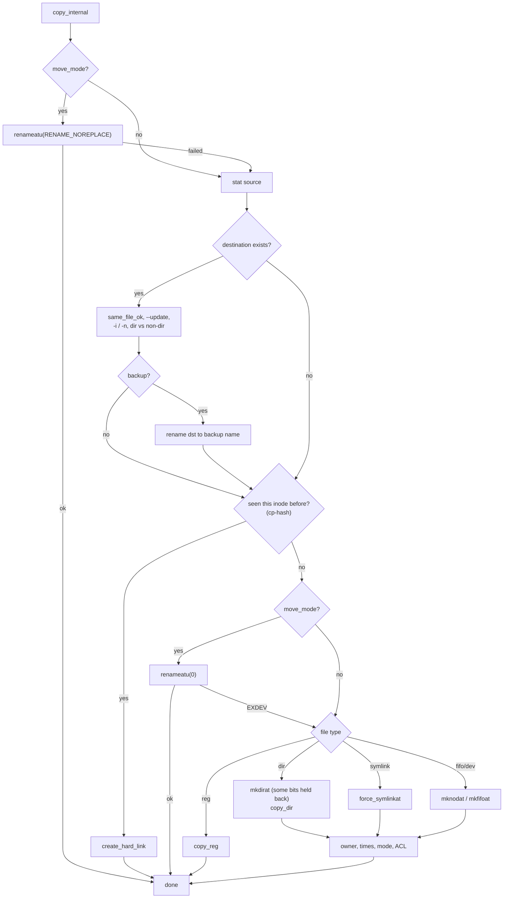
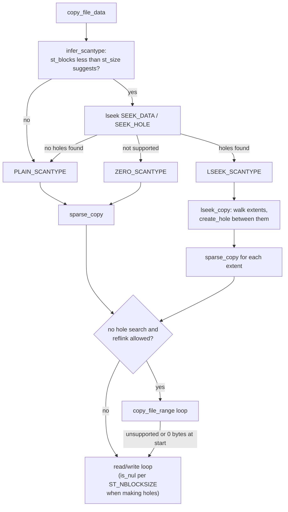

# Shared infrastructure

This page describes the code that more than one program uses: the
coreutils modules in `src/`, the coreutils-specific gnulib modules in
`gl/`, and the gnulib modules you will see most often. The
[Source layout](source-layout.md) page shows which programs link which
module.

## `src/system.h`

Every program includes `system.h` after `config.h`. Apart from the option
macros described in [Program skeleton](program-skeleton.md), it gives:

| Item | Purpose |
|---|---|
| `STREQ_LEN`, `STRPREFIX`, `STRNCMP_LIT` | String comparison helpers. |
| `dot_or_dotdot`, `readdir_ignoring_dot_and_dotdot`, `directory_status` | Directory helpers. `directory_status` returns `DS_EMPTY`, `DS_NONEMPTY` or an errno value. `rm -d` uses it. |
| `ignorable_traversal_errno` | `ENOENT` while walking a tree: the file was removed while we were looking. |
| `is_nul (buf, len)` | Fast "is this buffer all zero bytes?" test. Used for sparse copies (`cp`, `dd`). |
| `gcd`, `lcm`, `ptr_align` | Help with buffer sizes and alignment. |
| `usable_st_size` | `true` for regular files, symlinks, and shared-memory or typed-memory objects, whose `st_size` can be used. |
| `quotef`, `quoteaf`, `quoteN` | Quoting of file names in messages. |
| `emit_*_note` functions | Shared paragraphs in `--help` output. |
| `select_plural` | Map a large count into `unsigned long` for `ngettext`. |
| `devmsg`, `timetostr`, `bad_cast` | Debug output and small conversions. |
| `EXIT_TIMEDOUT` … `EXIT_ENOENT` | Exit statuses 124 to 127 for programs that run commands. |

## `src/ioblksize.h`: choosing a buffer size

`io_blksize (struct stat const *st)` returns the buffer size used by `cat`,
`copy.c`, `split` and others. The base value is
`IO_BUFSIZE = 256 * 1024`. A long comment (`src/ioblksize.h:23-77`) gives
`dd` throughput results on eleven systems and says that, as of February
2024, 256 KiB gave the lowest system-call overhead on most systems. The function rounds `IO_BUFSIZE` up to a multiple of
`st_blksize`. For a regular file, if the result is not a power of two, it
uses the next power of two. A comment says this works around ZFS, which
sometimes reports a block size that is too small.

## `copy.c`: the copy engine

`copy.c` (2901 lines) is the shared engine for [cp](../commands/cp.md),
[mv](../commands/mv.md) and [install](../commands/install.md). Each program
fills in a `struct cp_options` (`src/copy.h`) and calls:

```c
bool copy (char const *src_name, char const *dst_name,
           int dst_dirfd, char const *dst_relname,
           int nonexistent_dst, const struct cp_options *options,
           bool *copy_into_self, bool *rename_succeeded);
```

The table compares the three callers.

| Field | `cp` default | `mv` | `install` |
|---|---|---|---|
| `move_mode` | `false` | `true` | `false` |
| `install_mode` | `false` | `false` | `true` |
| `dereference` | `-R`: never, else always | never | always |
| `recursive` | `-R` | `true` | `false` |
| `preserve_*` | `false` (`-p`, `-a`) | all `true` | `false` (`-p`: times only) |
| `copy_as_regular` | `true` (`false` with `-R`) | `false` | `true` |
| `unlink_dest_before_opening` | `--remove-destination` | `false` | `true` |
| `set_mode`, `mode` | `false` | `false` | `true`, 0600 |

### Main functions

| Function | Location | Role |
|---|---|---|
| `copy` | `src/copy.c:2802` | Public entry point. Checks `valid_options` and calls `copy_internal`. |
| `copy_internal` | `:1618` | About 1100 lines. Stat the source and destination, handle "same file", `--update`, prompts, backups, hard-link tracking, the `mv` rename, then send the work to the right function for the file type. Finally set owner, mode, times and ACLs. |
| `copy_reg` | `:724` | Regular files: safe open, reflink, `copy_file_data`, attributes. |
| `copy_dir` | `:375` | `savedir`, then `copy_internal` for each entry. |
| `same_file_ok` | `:1159` | Decide whether source and destination are "the same" in a way that would destroy data. |
| `create_hard_link` | `:1543` | `force_linkat` with messages (for `cp -l`, and for links found with `preserve_links`). |
| `set_owner`, `set_process_security_ctx`, `copy_attr` | `:478`, `:571`, `:318` | Owner, SELinux and xattr handling. |
| `emit_debug` | `:173` | `--debug` output. |
| `cp_options_default` | `:2830` | Common defaults before each program's own `cp_option_init`. |

### Steps for one file in `copy_internal`

The diagram shows the main steps for one source file.



### Safety rules

Many comments in `copy.c` explain how it avoids races and data loss:

- **Re-check the source.** `copy_reg` compares the device and inode from
  `fstat` on the open descriptor with the earlier `stat`. A file that was
  replaced in between is skipped.
- **Never write through a symlink by accident.** A new destination is
  created with `O_EXCL`. If that fails because a dangling symlink is in the
  way, `cp` fails, unless `POSIXLY_CORRECT` is set
  (`open_dangling_dest_symlink`).
- **Hold back permissions.** New directories, and files whose owner will
  change, are first created without some group and other bits
  (`omitted_permissions`, `src/copy.c:2290-2299`). The full mode is set
  only after the owner is right.
- **Owner before xattrs.** `copy_reg` sets the owner before copying xattrs,
  because changing the owner clears file capabilities (`:1064-1065`).
- **Directory loops.** `is_ancestor()` walks a linked list of the
  directories currently being copied. A comment says it should be a hash
  table for very deep trees.

## `copy-file-data.c`: moving the bytes

`copy_file_data()` was split out of `copy.c`. It copies data from one
descriptor to another and handles sparse files, copy offload and buffer
sizes. Only `copy_reg` calls it.



Details:

- **Buffer size.** It starts with `io_blksize (dst)`. When it is not making
  holes, it rounds up to the least common multiple of the source and
  destination block sizes (`buffer_lcm`, from `gl/lib/buffer-lcm.c`). It
  uses no more than the file size plus one byte.
- **`copy_file_range` fallback.** `is_CLONENOTSUP()` lists the `errno`
  values that mean "use `read`/`write` instead": `ENOSYS`, `ENOTTY`,
  `ENOTSUP`, `EINVAL`, `EBADF`, `EXDEV`, `ETXTBSY`, `EPERM` and `EACCES`.
  A return of 0 bytes at the start also causes the fallback, because Linux
  `/proc` files report size 0. Comments also cover `EFBIG` on Linux 6.17
  and `ENOENT` on CIFS.
- **Holes.** `create_hole` seeks forward and calls `punch_hole`
  (`fallocate (FALLOC_FL_PUNCH_HOLE | FALLOC_FL_KEEP_SIZE)`), so XFS does
  not keep space it allocated in advance. A hole at the end of the file is
  made with `ftruncate`.
- **Readahead hint.** `fdadvise (FADVISE_SEQUENTIAL)` is used only for
  whole-file copies when reflink or sparse is not `auto`.

## `cp-hash.c` and `force-link.c`

- `cp-hash.c` keeps a hash table that maps (device, inode) to a
  destination name. `remember_copied()` adds an entry, and
  `src_to_dest_lookup()` finds one. `forget_created()` removes one. `cp`
  uses it to keep hard links (`-a`, `--preserve=links`) and to find a
  directory being copied into itself.
- `force-link.c` gives `force_linkat()` and `force_symlinkat()`. These
  replace an existing name atomically: they make the link under a
  temporary `CuXXXXXX` name in the same directory, then `renameat` it over
  the old name. See [ln](../commands/ln.md#atomic-replacement).

## `remove.c`: the removal engine

`rm (char *const *file, struct rm_options const *x)` removes a list of
operands with gnulib `fts` (`FTS_CWDFD | FTS_NOSTAT | FTS_PHYSICAL`).
[rm](../commands/rm.md) and [mv](../commands/mv.md) use it.
`struct rm_options` (`src/remove.h`) holds the prompt mode, recursion,
root protection and `require_restore_cwd`. Statuses are ordered by how
serious they are (`RM_OK` < `RM_USER_ACCEPTED` < `RM_USER_DECLINED` <
`RM_ERROR`), and `UPDATE_STATUS` keeps the worst one.

## `chown-core.c`

`chown_files()` walks the files with `fts` and changes the owner and
group. `chown` and `chgrp` share it. It has the race-free
`restricted_chown()` for `--from`. See [chown](../commands/chown.md).

## `iopoll.c`: noticing a closed reader

[tail](../commands/tail.md) and [tee](../commands/tee.md) use `iopoll.c`.
When their output is a pipe, they can stop as soon as the reader goes away,
without waiting for more input.

| Function | Purpose |
|---|---|
| `iopoll (fdin, fdout, block)` | Wait until `fdin` can be read or `fdout` becomes a broken pipe. Returns 0, `IOPOLL_BROKEN_OUTPUT` or `IOPOLL_ERROR`. |
| `iopoll_input_ok (fd)` | `false` for regular files and block devices, which are always "ready". |
| `iopoll_output_ok (fd)` | `true` only if `fd` is a pipe (`isapipe`). |
| `write_wait (fd, buf, size)` | `write` that waits with `poll` on `EAGAIN`, for non-blocking output. |

It uses `poll()` on Linux, Android, AIX, Solaris and macOS 11 or later,
and `select()` elsewhere. With `poll()` it watches `fdout` for
`POLLERR | POLLHUP | POLLNVAL`. The comment at `src/iopoll.c:21-25` gives
the platform reasons. It refuses to build with gnulib's `poll` replacement.

## Other small modules

| Module | Used by | Purpose |
|---|---|---|
| `set-fields.c` | `cut`, `numfmt` | `set_fields (str, options)` parses `1,3-5,7-` into a sorted, merged array of `struct field_range_pair` (`frp`). It can also produce the complement. |
| `find-mount-point.c` | `df`, `stat` | `find_mount_point (file, st)` saves the working directory, then uses `chdir ("..")` to go up until the device number changes. Then it restores the working directory. |
| `temp-stream.c` | `split`, `tac` | `temp_stream (&fp, &name)` makes one temporary file (honouring `$TMPDIR`) that is reused, so non-seekable input can be read more than once. |
| `selinux.c` | `cp`, `mv`, `install`, `mkdir`, `mknod`, `mkfifo` | `defaultcon()` and `restorecon()`: set the SELinux creation context, or fix the label of an existing file. |
| `show-date.c` | `date`, `du` | `show_date (format, when, tz)` formats a time stamp with `fprintftime`. |
| `prog-fprintf.c` | `mkdir`, `rmdir`, `install` | `prog_fprintf` prints `PROGRAM: message\n` to a stream (for `-v` output). |
| `relpath.c` | `ln -r`, `realpath --relative-to` | Relative path between two canonical names. |
| `group-list.c` | `id`, `groups` | `print_group_list`, `print_group`. |
| `operand2sig.c` | `kill`, `timeout`, `env` | Convert a signal name or number. |
| `expand-common.c` | `expand`, `unexpand` | Tab-stop parsing. |
| `fts-missing.h` | `chmod`, `chown` | Ignore files that disappear during a walk. |
| `statx.h` | `stat`, `ls` | Convert `struct statx` to `struct stat`. |
| `splice.h` | `cat` | Shared settings for `splice`/`vmsplice`. |

## Coreutils-specific gnulib modules (`gl/`)

These modules are written in gnulib style but kept in this repository,
because only coreutils uses them:

| Module | Purpose |
|---|---|
| `buffer-lcm` | LCM of two buffer sizes, with a maximum. |
| `cl-strtod`, `cl-strtold` | Parse floating-point numbers in the C locale or the user's locale (`sleep`, `seq`, `printf`, `tail`, `timeout`). |
| `dtimespec-bound` | Bounds for converting `double` to `timespec`. |
| `fadvise` | `fdadvise` and `fadvise` wrappers around `posix_fadvise`. |
| `fd-reopen` | Open a file on a given descriptor number (`touch`, `dd`, `split`, `csplit`, `nohup`, `stty`). |
| `heap` | Binary heap (`sort`). |
| `mbbuf` | Multibyte input buffer. |
| `randint`, `randperm`, `randread`, `rand-isaac` | Random numbers (`shuf`, `shred`, and `sort -R` through `randread`). |
| `root-dev-ino` | `get_root_dev_ino`, `ROOT_DEV_INO_CHECK`, `ROOT_DEV_INO_WARN` for `--preserve-root`. |
| `skipchars` | Skip fields or characters (`uniq`, `join`, `numfmt`). |
| `smack` | Thin wrappers for the SMACK security module. |
| `strnumcmp`, `strintcmp` | Compare numeric strings without converting them (`sort -n`, `expr`, `test`). |
| `targetdir` | `target_directory_operand()`: open the last operand as a directory (`cp`, `mv`, `install`). |
| `utf8` | UTF-8 helpers. |
| `xdectoint` | `xdectoimax`, `xdectoumax`, `xnumtoumax`: parse numbers and exit on error. |
| `xfts` | `xfts_open`: `fts_open` with `FTS_CWDFD` always added, that exits on memory exhaustion. Also `cycle_warning_required` for `FTS_DC` entries. |

## Gnulib modules you will see often

| Module | Typical calls |
|---|---|
| `fts` | `fts_open`, `fts_read`, `fts_set`. Walking trees (`rm`, `chmod`, `chown`, `du`, `chcon`). |
| `savewd`, `mkdir-p`, `mkancesdirs` | Making parent directories (`mkdir -p`, `install -D`). |
| `quotearg` | Quoting styles behind `quote`, `quotef` and `quoteaf`. |
| `xalloc` | `xmalloc`, `xpalloc`, `xstrdup`. |
| `argmatch` | `XARGMATCH` for option values such as `--sparse=auto`. |
| `xstrtol`, `xstrtoumax` | Numbers with size suffixes. |
| `full-read`, `full-write`, `safe-read` | I/O loops that handle short reads and writes, and `EINTR`. |
| `closeout`, `closein` | `close_stdout`, `close_stdin` for `atexit`. |
| `readutmp` | Login records (`who`, `users`, `pinky`, `uptime`). |
| `parse-datetime` | Free-form dates (`date -d`, `touch -d`). |
| `modechange` | `mode_compile` and `mode_adjust` (`chmod`, `mkdir`, `install`). |
| `userspec` | `parse_user_spec` (`chown`, `id`). |
| `backupfile` | `find_backup_file_name`, `xget_version` (`cp`, `mv`, `ln`, `install`). |
| `acl`, `qcopy-acl` | `xcopy_acl`, `xset_acl` (`copy.c`). |
| `renameatu` | `renameat2` with `RENAME_NOREPLACE` and `RENAME_EXCHANGE`, or a fallback (`mv`). |
| `linebuffer` | Read whole lines (`uniq`, `join`, `comm`, `nl`, `shuf`). |
| `hash` | Hash tables (`cp-hash.c`, `ln`, `sort`, `tail`, `df`, `ls`, `env`). |
| `di-set` | Set of (device, inode) pairs (`du`, to count hard links once). |
